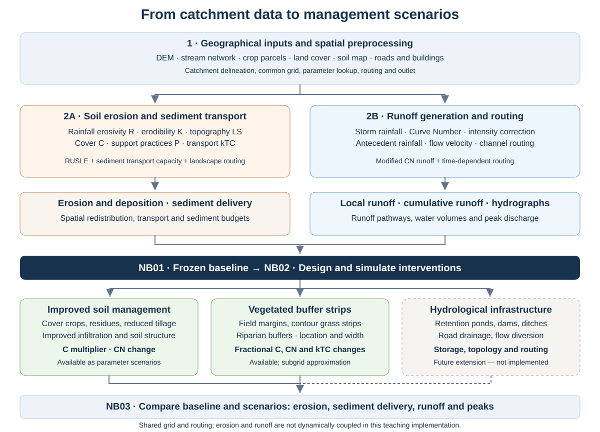

# LGEO2270 — WaTEM/SEDEM methodology and technical reference

This document explains the baseline teaching implementation. It is not a calibrated model or a complete description of WaTEM/SEDEM. The student notebook is the authoritative executable implementation; the exported parameter and provenance files record effective settings.

# LGEO2270 | Physical geography excursion
## WaTEM/SEDEM — NB01: Catchment baseline
**Condroz–Famenne · Soil erosion, runoff and landscape connectivity**

School of Geography · Earth and Life Institute · UCLouvain

### Model concept

[Open full-size model diagram](https://github.com/kvanoost/Watem/blob/main/assets/model_workflow.svg)

The branches share the spatial domain and routing framework; event sediment production is erosivity-based, not dynamically coupled to runoff. Channel runoff uses explicit D8 links when enabled.

**How to use this notebook:** Run the seven numbered code blocks in order. Confirm both maps explicitly. All computations are local to the Colab runtime; no Google Drive mount. Retain the final ZIP for NB02 and NB03. This is a teaching model, not a calibrated forecast.

[Official UCLouvain logo and graphic charter](https://uclouvain.be/fr/presse/logo-de-l-uclouvain)

**Simulation design:** one annual erosion run and one 40 mm rainfall event per baseline or management scenario.

## 2. Download terrain and prepare hydrology
Software: pinned pywatemsedem, WaTEM/SEDEM 5.0.3 and SAGA-WaTEM. No tutorial geographical files or Git LFS downloads are required. Model settings are embedded as a local teaching preset; an exact checksum-verified cached Langegracht INI is used if available. The preset is based on the upstream Molenbeek example and wrapper tests and is not verified identical to Langegracht.

| Web input | Source resolution / type | Conversion |
|---|---|---|
| Copernicus GLO-30 elevation | ~30 m | Bilinear resampling to 20 m Belgian Lambert 72; optional supplied SPW DEM |
| ESA WorldCover 2021 v200 | 10 m | Nearest-neighbour resampling to common grid |
| SPW RHW river axes | Vector | Rasterize for stream burning; condition DEM with SAGA sink filling |

The 20 m grid does not imply 20 m original elevation detail. D8 flow directions and contributing area are then computed from the conditioned DEM. A fixed 12 km margin surrounds the initial search extent.

Software diagnostics are hidden by default; enable VERBOSE in block 1 to see them. Final effective settings are displayed in block 5, not the initial template.

Block 2 reports five timed stages. Software is reused within the same runtime when the pinned version is available. A new Colab runtime still needs installation; remote raster and river services and the initial D8 numerical compilation can be slow. Debug output is off by default.

Terrain coverage: a fixed 12 km margin surrounds the initial search area (approximately 30 × 30 km for a point). No student buffer setting is required. The outlet map checks upstream coverage and area before confirmation. Select yellow or orange channels; grey channels have incomplete coverage and red channels exceed the 5,000 ha classroom limit.

## 4. Delineate and inspect the watershed
The original D8 watershed raster defines the active domain. Check its area, boundary and agricultural fraction. If unsuitable, return to block 3, move and confirm the outlet and rerun block 4. Only continue if the watershed is acceptable.

## 5. Download catchment data and convert to model inputs
Tick ACCEPT only after inspecting the watershed. The following layers are clipped to the basin and exported for GIS inspection.

| Downloaded dataset | Role |
|---|---|
| SPW SIGEC agricultural parcels (2025) | Crop labels → provisional crop C and CN, parcel IDs |
| SPW CNSW soil map | Soil interpretation only; K and HSG are not yet derived from it |
| SPW PICC roads, buildings, standing water | Infrastructure and water classes in PRC |
| SPW RHW streams | Reference and terrain conditioning; NOT the final model river raster |
| ESA WorldCover | Background forest, grass, cropland, water and built-up classes |

Final inputs: aligned conditioned DTM; exact D8 mask; PRC (positive parcel IDs and negative land-use codes, zero outside); C-factor raster with forest 0.001 and grass 0.01; provisional uniform K=30 and HSG B; CN raster; P and transport-capacity settings from tutorial; model river cells defined by contributing area ≥ MODEL_RIVER_HA. Native Idrisi exports are checked against the original D8 domain. The preview C map is not the final native C raster.

**CN extension:** the native implementation includes intensity correction `(I10/10)^alpha`, antecedent rainfall `AR5*beta` and negative rainfall excess representing potential reinfiltration. Defaults leave the first two corrections off; the negative deficit mechanism remains active. The cover/roughness CN equation is not used by the current lookup raster. Nonzero coefficients are experimental pending verification against the original thesis; AR5 is supplied in mm, not downloaded.

Event channel routing is enabled by default via ROUTE_CHANNEL_RUNOFF. This is explicit cell-to-cell D8 routing with the confirmed outlet, not native segment topology. Disable it to reproduce the earlier raster-only baseline.

### Parameter sources and assumptions

**C-factor:** the Walloon NVE manual reproduces the GISER crop lookup (Bielders et al. 2011, as cited in the manual). The teaching lookup currently uses: rapeseed 0.38, beet 0.41, cereals 0.39 (unweighted mean), maize 0.61, potatoes 0.64, flax/hemp 0.68. Grass 0.01, forest 0.001, other land 0.37 and water/infrastructure 0 are provisional teaching values associated with its other-cover table; verify the original source before scientific use. The generic crop fallback is our application of the other-land value, not a crop-specific estimate. The values are annual estimates; using them unchanged for individual storms is a teaching simplification.

**Curve Number:** USDA SCS (1986), *Urban Hydrology for Small Watersheds*, TR-55, tables 2-2a–c, reproduced by USACE HEC-HMS. HSG B and average antecedent runoff condition: CN 81 for straight-row crops in poor hydrologic condition; 76 for small grain in poor condition; 61 for pasture in good condition; 55 for woods in good condition; 98 for impervious surfaces. Applying row-crop CN 81 to every non-cereal crop and grassland CN 61 to grass strips is an analogy, not a crop-specific calibration. Open water and river CN 100 are modelling assumptions. HSG B is uniform and provisional; the soil map is not yet used to estimate HSG. The modified CN intensity and antecedent-rainfall terms are disabled by default.

**References**
- [Walloon NVE manual — Protection contre la perte en sol et l’érosion hydrique diffuse](https://natuurwaardeverkenner.marvintest.vito.be/docs/manual_FR/regulerende_diensten/Reguleren_stromen/erosie/) (GISER crop table and other-cover table).
- [USDA SCS TR-55 curve-number tables, reproduced by USACE HEC-HMS](https://www.hec.usace.army.mil/confluence/hmsdocs/hmstrm/cn-tables).
- [Panagos et al. (2015), Estimating the soil erosion cover-management factor at the European scale, Land Use Policy 48, 38–50](https://esdac.jrc.ec.europa.eu/content/cover-management-factor-c-factor-eu) — alternative European approach accounting for crop composition and management.
- [WaTEM/SEDEM model input documentation](https://watem-sedem.github.io/watem-sedem/input.html) — parameter definitions and time-scale consistency.

K and kTC remain provisional, not locally calibrated. The C and CN values are unchanged in this revision.

## 6. Run baseline simulations and inspect the model atlas
Annual erosion plus one synthetic 40 mm event. The native input atlas shows the actual model rasters; separate output atlases show erosion, sediment transport and hydrology. Total runoff is cumulative water reaching each cell in m³, not a map of independent runoff production. Event channel routing uses explicit D8 links through the native forced-routing mechanism and a manual outlet raster; the separate river-segment extension remains off. Annual settings are unchanged. The new event routing requires numerical testing and water balance verification. The sediment event response remains erosivity-based.

## 7. Export the portable GIS package
Save the ZIP locally. It contains source and derived GIS layers, data lineage and parameter records, verified native model inputs, baseline results and empty scenario templates for NB02.

## Numerical safeguards and map conventions

The outlet map uses an independently accumulated D8 graph and a boundary-connected flag. Yellow: 50–1000 ha; orange: >1000–5000 ha; red: >5000 ha; grey: incomplete coverage; blue: mapped RHW; purple: initial location; green: selected outlet. The basin is delineated by reverse traversal and checked against the graph count. A raster rim intersection is rejected. The 5000 ha limit is a teaching safeguard, not a model limitation.

The native inputs are repaired where necessary: exact D8 mask, full rectangular conditioned DEM, outside parcel codes zero, full-grid constant K. Input and output QA checks remain active even when diagnostics are hidden. The ZIP includes effective_model_settings.csv, data_lineage.csv, native_C_coverage.csv, parcel_parameters.csv, channel_routing_links.csv and the model atlases. Detailed console diagnostics are available by opening block 1 code and changing VERBOSE to True. The visible form intentionally omits experimental CN coefficients and routing controls.

The 40 mm synthetic event uses the existing fixed rainfall shape, 60 s routing timestep and 720 minute simulation duration; rainfall intensity and antecedent corrections default to zero. Signed rainfall excess includes potential reinfiltration deficit, not measured infiltration. Cumulative runoff is not a spatially additive water budget. Event sediment production remains erosivity-based; do not interpret it as dynamically coupled to discharge.

The reference links and parameter attribution above are inherited from the notebook; they have not been independently reverified in this editorial revision.
